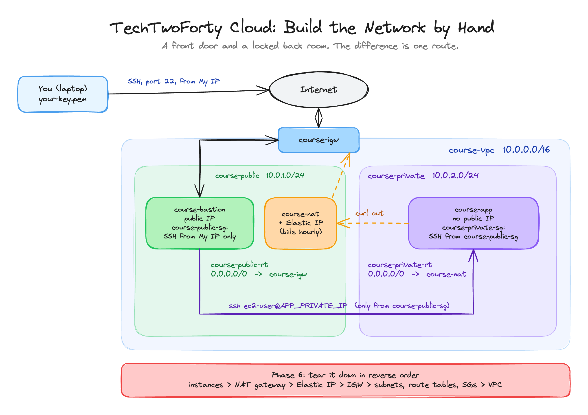

<p align="center">
  
</p>

<h1 align="center">TechTwoForty: Cloud</h1>
<p align="center"><b>Build the Network by Hand</b> · the finished project</p>
<p align="center">
  <a href="https://github.com/wjpearce-github/TechTwoForty-Scripting">← Previous: Scripting</a> ·
  <a href="https://github.com/wjpearce-github/TechTwoForty-Start-Here">Course map</a> ·
  <a href="https://github.com/wjpearce-github/TechTwoForty-Terraform">Next: Terraform →</a>
</p>

> [!TIP]
> **This repo is the finished template for the Cloud project. Treat it as your cheat sheet.**
> This project is built by clicking in the AWS console, so there is no code to copy. Instead you get the exact build sheet (every name, CIDR, route and rule), a script that checks your build against each checkpoint, and a script that proves the teardown really happened.

| | |
|---|---|
| **Section** | 3 of 10 · AWS |
| **Time** | About 75 minutes, 6 phases |
| **Runs in** | The AWS console |
| **Cost** | The NAT gateway bills about $0.045 an hour plus data from the moment it exists. Tear it down |
| **Deliverable** | A public/private network with a bastion, a private server you reach only through it, and proof the private server can still get out. Then an empty account |

## The big picture



<sub>Drawn in Excalidraw. To edit it, open <code>assets/diagram.excalidraw</code> at <a href="https://excalidraw.com">excalidraw.com</a>.</sub>

The one idea to take away: the two subnets are identical until you add the routes. **Public** means its route table sends `0.0.0.0/0` to the internet gateway. **Private** means it sends `0.0.0.0/0` to the NAT gateway, a one-way door.

## What is in this repo

```text
TechTwoForty-Cloud/
└── scripts/
    ├── verify-network.sh    Checks checkpoints 1 to 5 against your account (read-only)
    └── teardown-check.sh    Checkpoint 6: no NAT, no Elastic IP, no instances, no VPC
```

```bash
bash scripts/verify-network.sh     # after Phase 5
bash scripts/teardown-check.sh     # after Phase 6
```

Both only run `describe` calls. They change nothing in your account.

## The build sheet

Build in this order. Each piece depends on the one before it. That same order is what Terraform works out for itself in the next section.

### Phase 1 · The rooms

| Resource | Name | Setting |
|---|---|---|
| VPC (VPC only) | `course-vpc` | `10.0.0.0/16`, default tenancy |
| Subnet | `course-public` | `10.0.1.0/24`, any AZ |
| Subnet | `course-private` | `10.0.2.0/24`, the **same** AZ |

### Phase 2 · The doors

| Resource | Name | Setting |
|---|---|---|
| Internet gateway | `course-igw` | Create, **then** Actions, Attach to VPC, `course-vpc` |
| NAT gateway | `course-nat` | Subnet `course-public`, allocate a new Elastic IP. **Billing starts here** |

> [!NOTE]
> The NAT lives in the **public** subnet. It needs a public address to do its job on behalf of the private room.

### Phase 3 · The signposts

| Route table | Route | Associated with |
|---|---|---|
| `course-public-rt` | `0.0.0.0/0` → `course-igw` | `course-public` |
| `course-private-rt` | `0.0.0.0/0` → `course-nat` | `course-private` |

### Phase 4 · The guest lists

| Security group | Inbound rule | Source |
|---|---|---|
| `course-public-sg` | SSH, port 22 | **My IP** (your address with `/32`) |
| `course-private-sg` | SSH, port 22 | **The security group `course-public-sg` itself**, not an address |

### Phase 5 · Two servers and the proof

| Instance | AMI / type | Subnet | Public IP | Security group |
|---|---|---|---|---|
| `course-bastion` | Amazon Linux 2023, t2.micro | `course-public` | **Enable** | `course-public-sg` |
| `course-app` | Amazon Linux 2023, t2.micro | `course-private` | **Disable** | `course-private-sg` |

```bash
ssh -i your-key.pem ec2-user@BASTION_PUBLIC_IP    # from your machine
ssh ec2-user@APP_PRIVATE_IP                       # from the bastion
curl -I https://aws.amazon.com                    # from the private server: HTTP/2 200
```

> [!IMPORTANT]
> To hop onward, the key has to be on the bastion too. Copy it there (fine for a lab) or use `ssh -A` for agent forwarding.

### Phase 6 · Tear it down (not optional)

In this order: terminate both instances, delete the NAT gateway (this stops the charges), release the Elastic IP, detach and delete the internet gateway, delete the subnets, route tables and security groups, delete the VPC. Then:

```bash
bash scripts/teardown-check.sh
```

## Final handover check

- [ ] You can draw the topology from memory: two subnets, two gateways, two route tables, two security groups, two instances
- [ ] You can explain in one sentence why the private subnet is private
- [ ] The account is empty and the billing page shows nothing running

## Common mistakes

| Mistake | What happens | The fix |
|---|---|---|
| Creating the internet gateway but not attaching it | The "public" subnet is not public | Actions, Attach to VPC |
| Putting the NAT gateway in the private subnet | The private server still cannot get out | The NAT goes in `course-public` |
| Using an IP as the private SG's source | It breaks when addresses change | Pick `course-public-sg` itself |
| Leaving the Elastic IP allocated | A small charge every hour, forever | Release it after deleting the NAT |
| Skipping the teardown | A NAT gateway bills all month | `teardown-check.sh` must pass |

## What you can now do

- **VPC design:** subnets, gateways and route tables assembled into a public/private layout
- **The bastion pattern:** one entry point, everything else unreachable from outside
- **Security group referencing:** rules that name other groups instead of addresses
- **Cost discipline:** knowing what bills, and tearing it down properly

Next section you build this exact network from a file, in one command.

---

<p align="center">
  <b>TechTwoForty</b> · Cloud · 3 of 10<br>
  <a href="https://github.com/wjpearce-github/TechTwoForty-Scripting">← Previous: Scripting</a> ·
  <a href="https://github.com/wjpearce-github/TechTwoForty-Start-Here">Course map</a> ·
  <a href="https://github.com/wjpearce-github/TechTwoForty-Terraform">Next: Terraform →</a>
</p>
